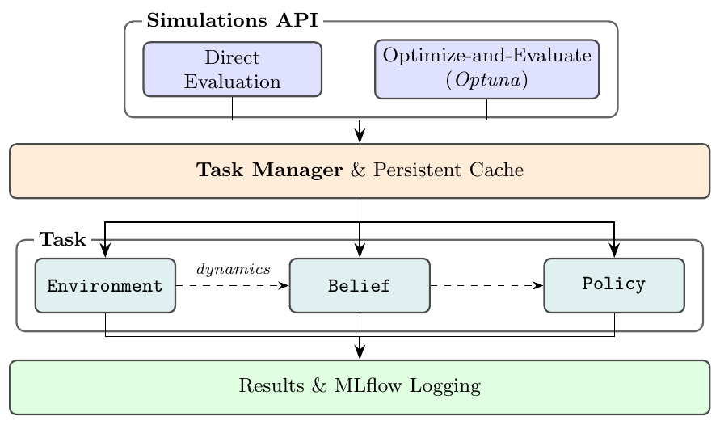

<!-- Every sentence below is copied from v1
(../open_source_pomdp_planning_package_v1/open_source_pomdp_python_package.tex)
with only its LaTeX markup converted to Markdown. Text that is new or changed
against v1 is set in red with \textcolor{red}{...}. -->

# Summary

POMDPPlanners is an open-source Python package for empirical evaluation of Partially Observable Markov Decision Process (POMDP) planning algorithms. The package integrates state-of-the-art planning algorithms, a suite of benchmark environments with safety-critical variants, automated hyperparameter optimization, persistent caching with failure recovery, and configurable parallel simulation---reducing the overhead of extensive simulation studies. POMDPPlanners is designed to enable scalable, reproducible research on decision-making under uncertainty, with particular emphasis on risk-sensitive settings, which standard toolkits do not support.

# Statement of need

POMDPs model sequential decision-making under uncertainty, with applications spanning robotics, autonomous navigation, and medical decision-making. Conducting robust, reproducible simulation studies, however, remains practically challenging: researchers must manually integrate planners, belief representations, and environments from disparate sources, implement hyperparameter search routines, and manage interrupted campaigns---all without standardized tooling in Python. Existing frameworks include C++ toolkits [@JMLR:ai_toolbox; @JMLR:madp_toolbox] and the Julia-based POMDPs.jl [@JMLR:julia_pomdp], while Python alternatives [@emami2015pomdpy; @zheng2020pomdp_py] implement only basic solvers and do not support continuous state, observation, and action spaces. POMDPPlanners addresses these gaps with a unified, extensible framework for POMDP planning research. The main contributions of the package are:

1. **A unified workflow for reproducible simulation studies:** Automated hyperparameter tuning, parallel evaluation on local machines and remote clusters, persistent caching, and recovery from interrupted runs reduce experimental setup work. A local web interface supports comparing results, replaying episodes, and customizing and exporting figures for academic papers.
2. **Benchmarks for safety and scalability:** Configurable hazards and safety metrics extend established POMDP environments for evaluating risk-averse planners. New environments with adjustable state, observation, and action space sizes allow researchers to assess performance as problem size increases.
3. **Integration with realistic simulators:** Common environment interfaces for CARLA and Isaac Lab support autonomous navigation and robot manipulation studies while reducing simulator-specific integration work.
4. **A shared interface for planning algorithms:** Implementations of standard and risk-averse planners use common interfaces for environments, beliefs, and hyperparameter tuning, making it easier to compare algorithms under consistent experimental settings.

# State of the field

Solving POMDP planning problems relies on computing large search trees that grow exponentially with the horizon, and are in general intractable [@Papadimitriou87math]. To address this complexity, online POMDP planners approximate search trees by simulating future trajectories during execution [@silver2010monte; @sunberg2018online], making computational efficiency a priority. These simulation intensive algorithms pushed the field of POMDP planning to use efficient programming languages like C++ [@JMLR:ai_toolbox; @JMLR:madp_toolbox] and Julia [@JMLR:julia_pomdp], where most of the new literature is in Julia [@moss2024betazero; @moss2024constrainedzero]. These computationally efficient programming languages prioritize efficiency over usage simplicity, thereby forcing researchers to focus on coding instead of research, thereby extending the delivery time of simulation studies for academic papers. In POMDPPlanners we resolve the efficiency problem by implementing vectorized belief updates for each environment in Python, and move environment-specific code to C++ while keeping core interfaces in Python. Recent work such as VOPP demonstrates fully vectorized online POMDP planning on GPUs using Python and PyTorch, further motivating Python-based planner implementations [@Hoerger25arxiv].   

The two existing POMDP planning python packages [@emami2015pomdpy; @zheng2020pomdp_py] are outdated, and implement only a small amount of simple planners that cannot solve POMDPs with continuous spaces, which is required to solve real-world problems. \autoref{tab:comparison} summarizes the key differences between our work and previous software tools.

: Comparison of POMDP planning frameworks. $\checkmark$ = supported; -- = not supported. All frameworks support discrete spaces; Cont. = continuous spaces; Hyp. opt. = automated hyperparameter optimization; Safety Envs. = safety-critical environments with violation metrics; Modern Planners = includes planners beyond POMCP appearing in post-2018 POMDP literature (e.g., POMCPOW, PFT-DPW, BetaZero). $^\dagger$POMDPs.jl provides a solver interface; planners are separate community packages. \label{tab:comparison}

| **Package**       | **Language** | **Cont.**    | **Modern Planners**     | **Hyp. opt.** | **Safety Envs.** | **Parallel** | **Caching**  |
|:--------------------------|:----------:|:-------:|:----------:|:-------:|:--------:|:----------:|:---------:|
| AI-Toolbox        | C++          | --           | --                      | --            | --               | --           | --           |
| MADP              | C++          | --           | --                      | --            | --               | --           | --           |
| POMDPs.jl         | Julia        | $\checkmark$ | $\checkmark^\dagger$    | --            | --               | $\checkmark$ | --           |
| pomdpy            | Python       | --           | --                      | --            | --               | --           | --           |
| pomdp\_py         | Python       | --           | --                      | --            | --               | --           | --           |
| **POMDPPlanners** | **Python**   | $\checkmark$ | $\checkmark$            | $\checkmark$  | $\checkmark$     | $\checkmark$ | $\checkmark$ |

## Software Design

The design of the package revolves around the problem it solves: comparing POMDP planning algorithms through large-scale simulations. This problem can be divided into three parts: comparable planner implementations, reliable execution of large simulation studies, and detailed analysis of results.

Comparing planners can be highly affected by data structures choices rather than algorithmic differences. To solve this we implemented efficient tree data structures that performed well during our development. All of our tree-based planners always use the most efficient tree data structure that we know of, thereby improving all of the implemented planners in our package and removing data-structure dependencies when comparing planning algorithms.

Evaluating these planners across environments and parameter settings then requires reliable execution of large simulation studies. The package combines automated parameter tuning using Optuna [@akiba2019optuna] with parallel execution on local machines and remote clusters using the Dask Python package. Persistent caching stores the results of completed episodes so that interrupted studies can resume without repeating completed work. Each episode runs as a standalone task wrapped with command pattern, and all of the tasks are dispatched using task-manager. The user runs simulations though the simulations API, and is agnostic to the implementation as specified in \autoref{fig:architecture}. 

{width="100%"}

Interpreting the results of these studies requires understanding what happens within each planner run. For example, a low mean return may reflect insufficient exploration caused by a poorly tuned exploration constant. The package therefore records a range of planner and environment metrics for each episode. These metrics are integrated easily through the environment and planner interfaces. Examples include action coverage, task completion, and safety violations, which help researchers diagnose planning behavior and assess success rates and risk. Cached trajectory visualizations complement these metrics: an agent that avoids every obstacle may simply have remained stationary.

# AI usage disclosure

AI tools were used in the developlemt of the package and for compact rephrasing of this paper. All of the results generated by these tools were reviewed.

# Acknowledgements

This work was supported by the Israel Ministry of Innovation, Science and Technology.

# References

::: {#refs}
:::
